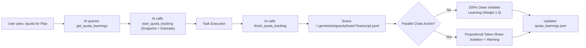

# ⚡ Antigravity Quota & Self-Learning Estimator (`antigravity-quota`)

[](LICENSE)
[](https://nodejs.org/)
[](https://modelcontextprotocol.io/)
[](#the-quota-slash-command)

A zero-dependency Model Context Protocol (MCP) server and Antigravity 2.0 Plugin that connects directly to the local **Google Antigravity 2.0** Language Server via ConnectRPC/gRPC-Web over HTTPS.

Enables AI agents to query live **5-hour (`5h`)** and **7-day (`weekly`)** quota limits, forecast how much quota a complex plan will consume via **`/quota`**, and **self-learn** from real pre/post task measurements — including **automatic parallel-chat noise detection**.

---

## 🎯 Key Features

- **⚡ Zero External Dependencies:** Built with pure Node.js standard libraries (`https`, `child_process`, `readline`, `fs`). No bulky `node_modules` required!
- **💬 Native `/quota` Slash Command:** Check live limits instantly or ask *"Wie viel `/quota` würde dieser Plan verbrauchen?"* for a deep consumption forecast.
- **🧠 Self-Learning Calibration Engine (`quota_learnings.json`):** Records the AI's pre-task consumption estimate alongside a live quota snapshot (`start_quota_tracking`) and compares it against the actual quota drop once the task completes (`finish_quota_tracking`). Automatically calculates per-model and per-category calibration multipliers so predictions become more accurate with every task.
- **🛡️ Automatic Parallel-Chat Noise Isolation:** Since Antigravity quotas are shared account-wide across all open chats, running parallel conversations during a task would normally skew the measured delta. `antigravity-quota` automatically inspects local `transcript.jsonl` logs across all active conversations during the task window, calculates the exact weighted token share of the tracked chat vs. background chats, and isolates true task consumption (`attributed5hUsedPercent` vs. `raw5hUsedPercent`).
- **🔍 Autonomous ConnectRPC Discovery:** Automatically locates running `language_server.exe` processes, extracts the ephemeral `--csrf_token`, and negotiates the active HTTPS port.

---

## 💬 The `/quota` Slash Command

 bundled in `skills/quota/SKILL.md`:

1. **Quick Status Check:**
   ```text
   /quota
   ```
   Outputs a compact summary of remaining 5-hour and weekly percentages and countdown timers for Gemini and Claude/GPT models.

2. **Deep Plan & Task Consumption Forecast:**
   ```text
   Wie viel /quota würde der Plan verbrauchen?
   ```
   - Inspects the planned scope (files, tool calls, subagents, model tier).
   - Consults `quota_learnings.json` for historical benchmarks and self-corrects using `calibrationMultiplier`.
   - Calls `start_quota_tracking` to snapshot current limits and store the estimate.
   - Upon task completion, calls `finish_quota_tracking` to measure real consumption, check for parallel chat interference, and update the learning store.

---

## 🛠️ Available MCP Tools

| Tool | Description |
| :--- | :--- |
| **`get_antigravity_quota_summary`** | Returns live 5-hour and 7-day (weekly) quota buckets (`remainingPercent`, `timeRemaining`, `resetTime`) plus current calibration statistics. |
| **`get_antigravity_model_quotas`** | Returns per-model live quota info and capabilities across all 13+ active models (Gemini 4 Argon, Gemini 3.8 Flash/Pro, Claude 3.7 Sonnet, etc.). |
| **`get_antigravity_user_status`** | Returns user account tier (`TEAMS_TIER_PRO`, etc.), plan status, and language server connectivity health. |
| **`start_quota_tracking`** | Snapshots live 5h & weekly quotas before a task starts and records the AI's estimated consumption in `quota_learnings.json`. |
| **`finish_quota_tracking`** | Measures the real post-task quota drop, scans `transcript.jsonl` across all chats for parallel activity, calculates isolated consumption, and updates `quota_learnings.json`. |
| **`get_quota_learnings`** | Retrieves historical task benchmarks, accuracy multipliers, and past runs filtered by model or category. |

---

## 🧠 How Self-Learning & Parallel-Chat Detection Works



When `finish_quota_tracking` runs, it returns a detailed breakdown:
- `estimated5hPercent`: What the AI predicted before starting.
- `raw5hUsedPercent`: Total account-wide 5h quota drop during the task window.
- `attributed5hUsedPercent`: Isolated quota consumption attributed to *this* specific chat based on `thisChatTokenShare`.
- `parallelNoise5hPercent`: Quota consumed by other chats running in parallel during the same timeframe.
- `parallelActivity.warningNote`: Explicit warning if background chats were active.

---

## 🚀 Setup & Installation

### 1. Register the MCP Server (`~/.gemini/config/mcp_config.json`)

```json
{
  "mcpServers": {
    "antigravity-quota": {
      "command": "node",
      "args": [
        "D:/Projekte/AGY-MCP/antigravity-quota/server.js"
      ]
    }
  }
}
```

### 2. Enable the Plugin & `/quota` Skill
Copy or link this repository into `~/.gemini/config/plugins/antigravity-quota` so Antigravity automatically loads `plugin.json`, `skills/quota/SKILL.md`, and `rules/AGENTS.md`.

---

## 📜 License

[MIT](LICENSE) © 2026 [NyboTV](https://github.com/NyboTV)
